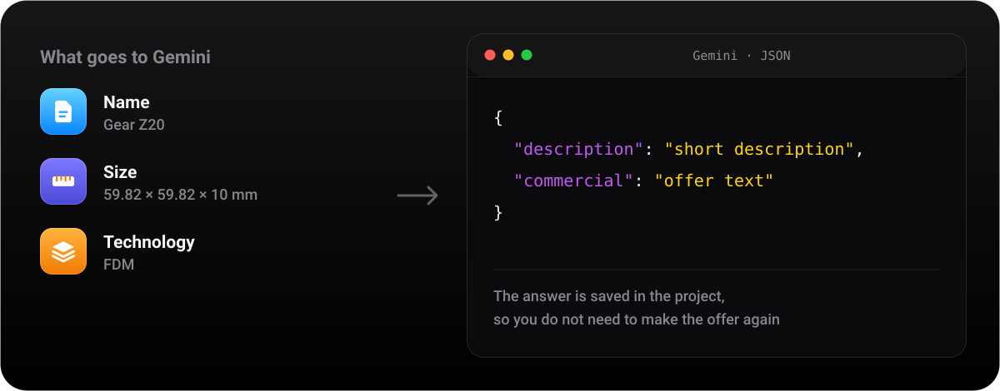
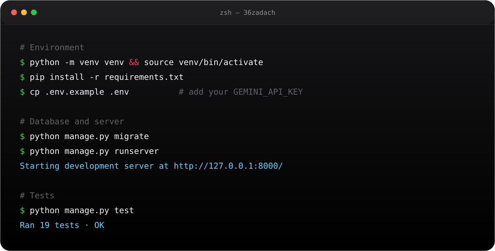
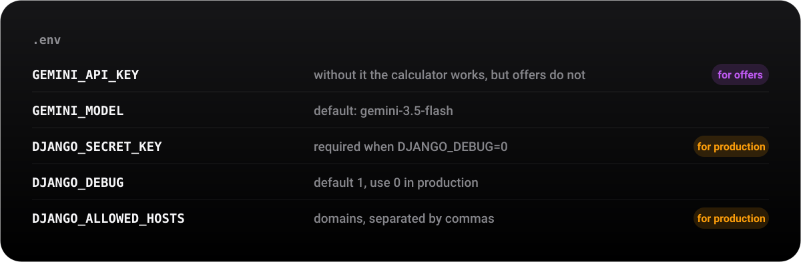
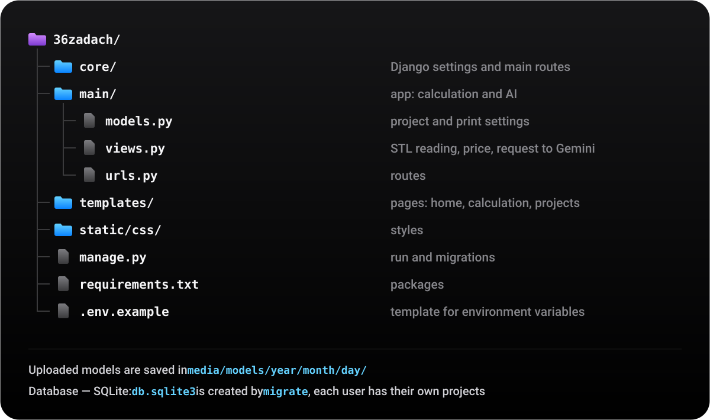

<p align="center"><b>English</b> &nbsp;|&nbsp; <a href="README.ru.md">Русский</a></p>

<a href="#how"></a>

<p align="center">
  <a href="#screens">In action&nbsp;›</a>&emsp;
  <a href="#features">Features&nbsp;›</a>&emsp;
  <a href="#how">How it counts&nbsp;›</a>&emsp;
  <a href="#ai">Offer&nbsp;›</a>&emsp;
  <a href="#run">Run&nbsp;›</a>&emsp;
  <a href="#structure">Structure&nbsp;›</a>
</p>

<br>



<br>
<br>

<p align="center">
  <i>«Any sufficiently advanced technology is indistinguishable from magic.»</i><br>
  <sub>— Arthur C. Clarke</sub>
</p>

<br>

<a name="screens"></a>




<br>
<br>

<a name="features"></a>


<a href="main/views.py"></a>
<a href="main/views.py"></a>
<a href="templates/main/calculate.html"></a>
<a href="main/views.py"></a>
<a href="templates/main/projects_list.html"></a>
<a href="main/models.py"></a>

<br>
<br>

<a name="how"></a>




<br>
<br>

<a name="ai"></a>




<br>
<br>

<a name="run"></a>




<details>
<summary>Copy the commands</summary>
<br>

```bash
python -m venv venv && source venv/bin/activate
pip install -r requirements.txt
cp .env.example .env        # add your GEMINI_API_KEY
python manage.py migrate
python manage.py runserver  # http://127.0.0.1:8000
python manage.py test       # 19 tests
```

</details>

<br>


<a href=".env.example"></a>

<br>
<br>

<a name="structure"></a>




<br>
<br>




<br>
<br>


<p align="center">
  <sub>Made with ☕ and Django &nbsp;·&nbsp; <a href="https://github.com/a1tvv">@a1tvv</a></sub>
</p>
