<p align="center"><a href="README.md">English</a> &nbsp;|&nbsp; <b>Русский</b></p>

<a href="#how"></a>

<p align="center">
  <a href="#screens">В деле&nbsp;›</a>&emsp;
  <a href="#features">Возможности&nbsp;›</a>&emsp;
  <a href="#how">Как считается&nbsp;›</a>&emsp;
  <a href="#ai">КП&nbsp;›</a>&emsp;
  <a href="#run">Запуск&nbsp;›</a>&emsp;
  <a href="#structure">Структура&nbsp;›</a>
</p>

<br>


<br>
<br>

<p align="center">
  <i>«Any sufficiently advanced technology is indistinguishable from magic.»</i><br>
  <sub>— Arthur C. Clarke</sub>
</p>

<br>

<a name="screens"></a>


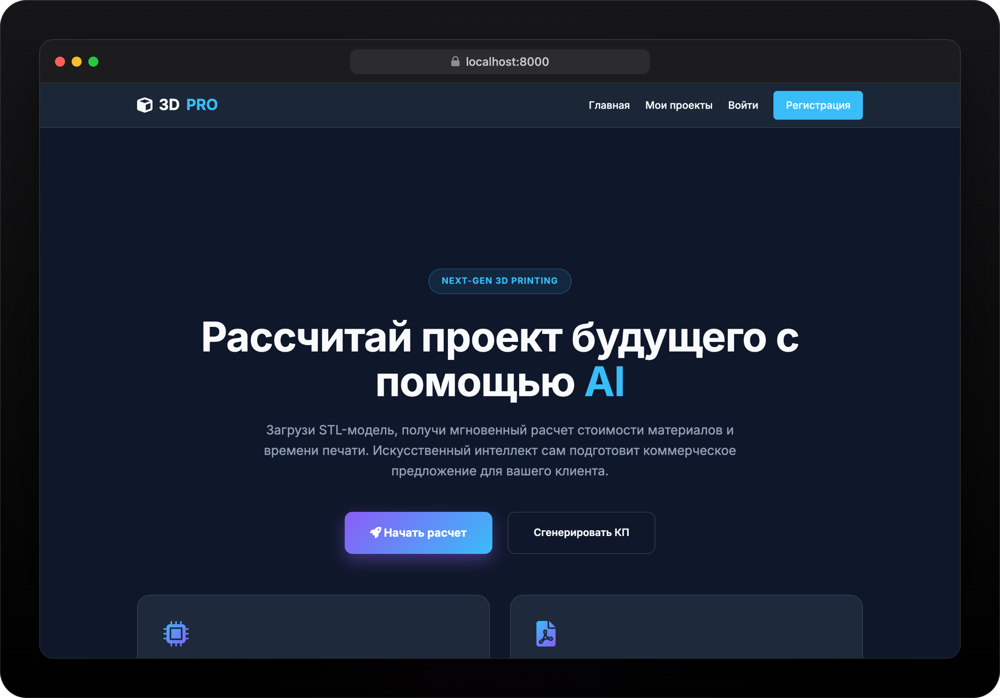


<br>
<br>

<a name="features"></a>
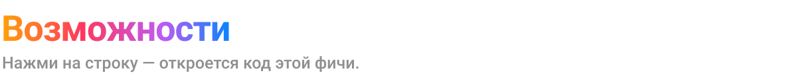

<a href="main/views.py">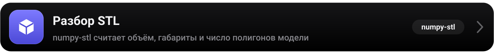</a>
<a href="main/views.py"></a>
<a href="templates/main/calculate.html"></a>
<a href="main/views.py"></a>
<a href="templates/main/projects_list.html"></a>
<a href="main/models.py">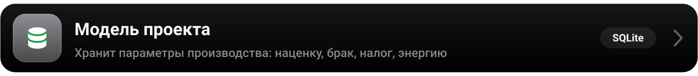</a>

<br>
<br>

<a name="how"></a>



<br>
<br>

<a name="ai"></a>
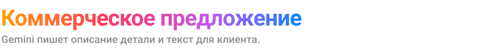

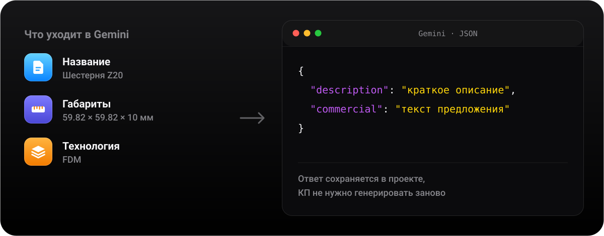

<br>
<br>

<a name="run"></a>
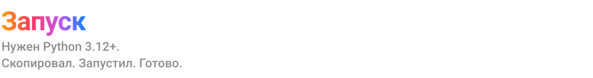

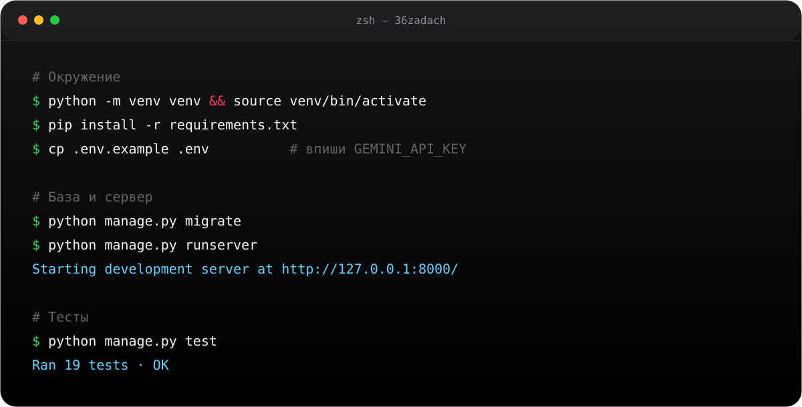

<details>
<summary>Скопировать команды</summary>
<br>

```bash
python -m venv venv && source venv/bin/activate
pip install -r requirements.txt
cp .env.example .env        # впиши GEMINI_API_KEY
python manage.py migrate
python manage.py runserver  # http://127.0.0.1:8000
python manage.py test       # 19 тестов
```

</details>

<br>


<a href=".env.example">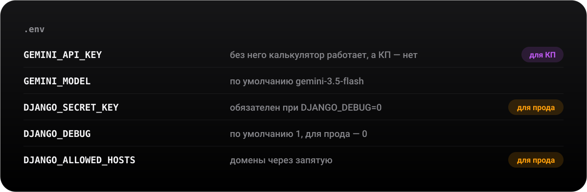</a>

<br>
<br>

<a name="structure"></a>
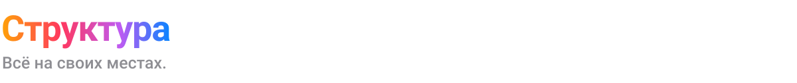

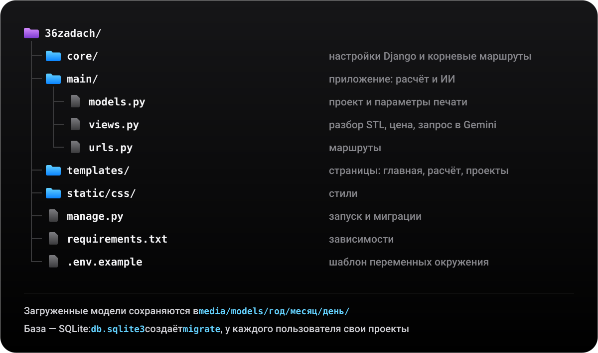

<br>
<br>



<br>
<br>


<p align="center">
  <sub>Сделано с ☕ и Django &nbsp;·&nbsp; <a href="https://github.com/a1tvv">@a1tvv</a></sub>
</p>
